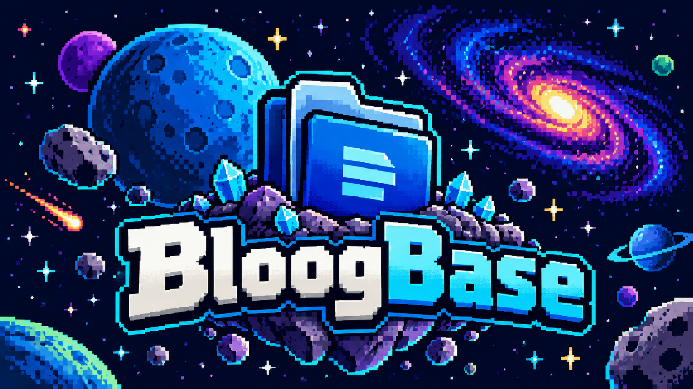
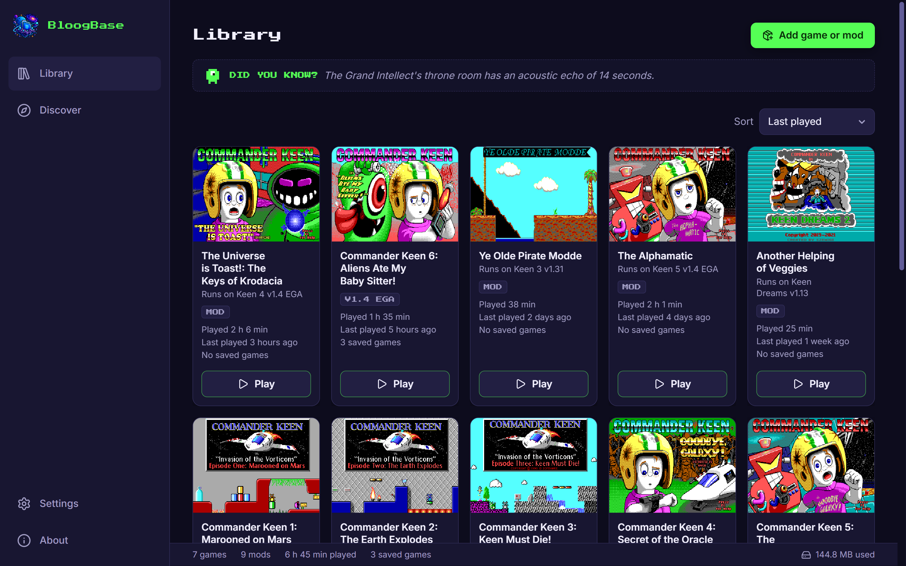
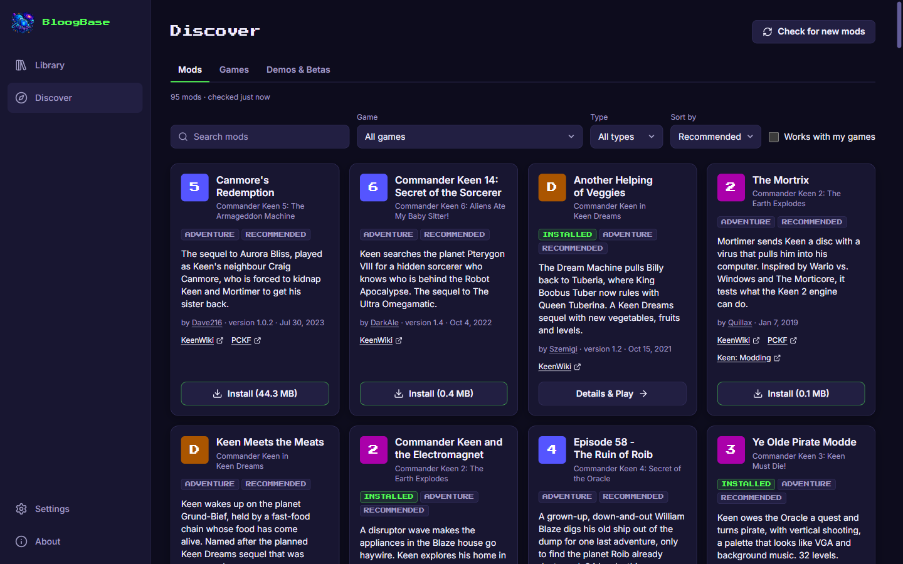
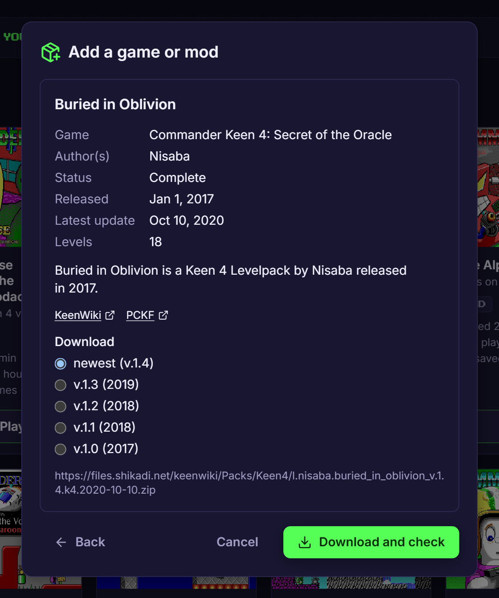
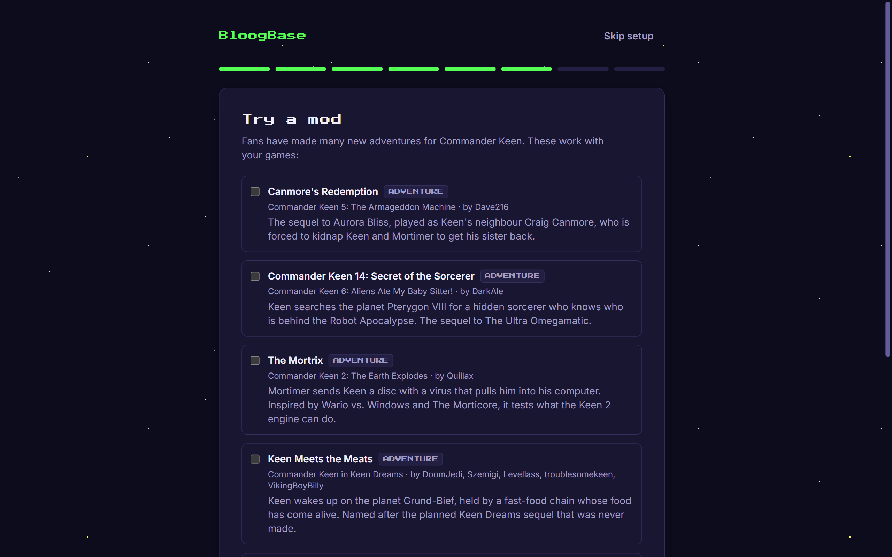
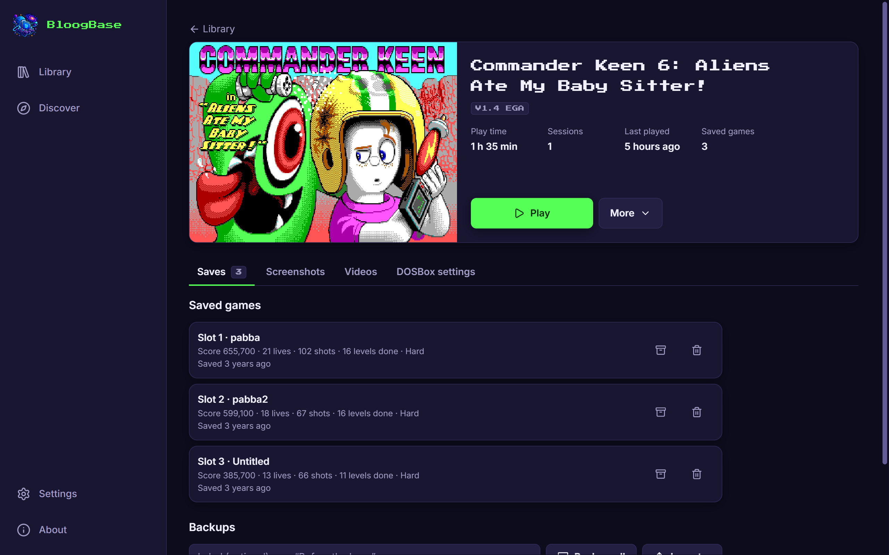
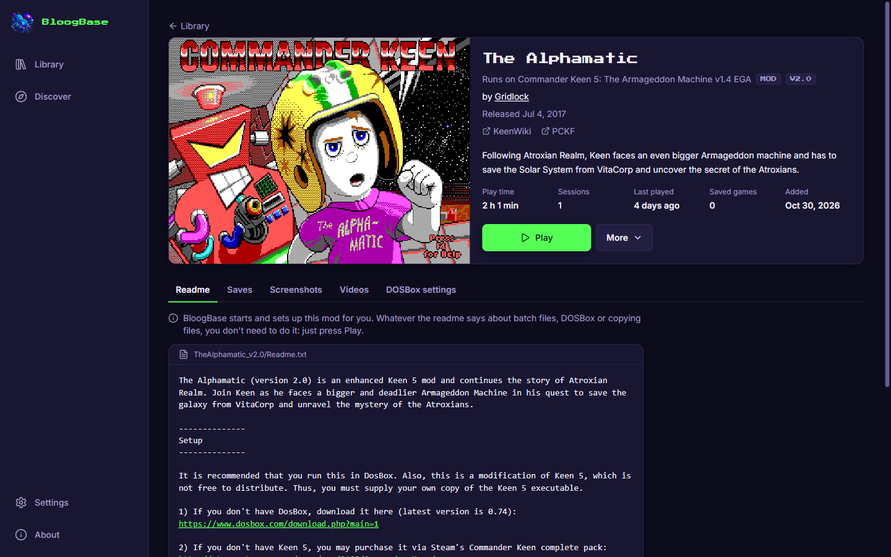
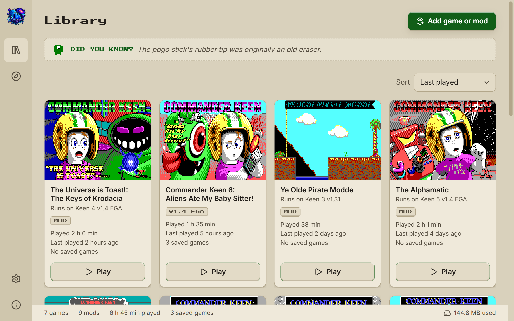
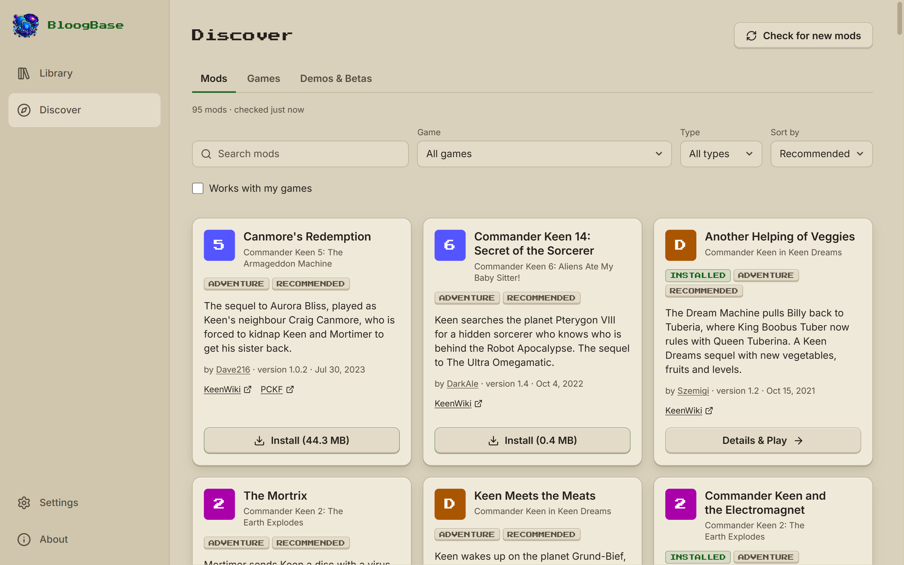

<p align="center"></p>

<p align="center">
  <strong>A cozy home for Commander Keen.</strong><br>
  Play the Keen games and the community's mods with a single click.<br>
  For Windows, macOS and Linux. Free and open source.
</p>

<p align="center">
  <a href="https://github.com/transporthummel/BloogBase/releases/latest"><strong>Download BloogBase</strong></a>
  ·
  <a href="#features">Features</a>
  ·
  <a href="#suggest-a-mod-or-give-feedback">Suggest a mod</a>
  ·
  <a href="#for-developers">For developers</a>
</p>

<p align="center"></p>

For more than thirty years, fans have built new adventures for Commander
Keen: new levels, new graphics, whole new episodes. Playing them used to mean
finding the right version of the game, unzipping archives into its folder,
running a patcher and setting up DOSBox by hand.

**BloogBase does all of that for you.** Pick a mod, click Install, click Play.
It downloads DOSBox Staging and the free shareware episodes, finds the games
you own on Steam and GOG, keeps every game's and mod's saves apart and safe,
and never touches your original game files.

It's made for people who remember Keen from their childhood and have never
opened DOSBox, for parents who want to let their kids dive into the
Keeniverse without a lot of setting up, and just as much for the fans who
know every mod on KeenWiki and want them all in one place.

## Download

<!-- Keep in step with .github/release-downloads.md, shown on every release. -->

Download the newest release for your system from the
[releases page](https://github.com/transporthummel/BloogBase/releases/latest).
BloogBase is a free fan project, so its installers aren't signed with paid
certificates; your system will ask once before the first start:

- **Windows:** `BloogBase_…_x64-setup.exe`. If "Windows protected your PC"
  appears, click _More info_ → _Run anyway_.
- **macOS:** `BloogBase_…_aarch64.dmg` (Apple Silicon) or `…_x64.dmg` (Intel).
  Move BloogBase to Applications and start it. When macOS blocks it, open
  _System Settings → Privacy & Security_ and click _Open Anyway_.
- **Linux:** `BloogBase_…_amd64.AppImage` (make it executable and start it) or
  the `.deb` for Debian/Ubuntu.

After that, BloogBase keeps itself up to date.

## Features

### Mods with one click



**Discover** lists close to a hundred community mods for every Keen game,
with descriptions, authors and links to their KeenWiki pages. Search and
filter them, or start with the recommended ones. One click downloads a mod
from its original source, checks it, puts it on the right copy of the game
and works out how it starts. The list updates itself, so new mods show up
without an app update.

### Any mod from KeenWiki



Found a mod on [KeenWiki](https://keenwiki.shikadi.net/) that isn't in the
list? Paste the link to its page. BloogBase reads the page, downloads the mod
and takes its title, description, authors and credits along. A ZIP or folder
of your own works too: drop it on the window, and BloogBase tells games from
mods and sets them up.

### Ready on the first start



A short setup downloads DOSBox Staging, looks for Keen on Steam and GOG, and
offers the free shareware episodes: Keen 1, Keen 4 and Keen Dreams, complete
games that hundreds of mods are made for. A few minutes after installing,
you're playing.

### Your saves are safe



Every game and every mod gets its own play profile with its own saves,
settings and high scores. The original game files are never changed, and a
save is in its final place the moment the game writes it. When a session
overwrites a save, BloogBase keeps the earlier one; any save can go back to an
earlier version, and removed games and mods offer their saves back when you
add them again.

### A fan museum for your collection



Covers are drawn from each game's and mod's own title screen, right from the
files on your computer. Every mod's page credits its authors, links to
KeenWiki and the forums, and shows its readme. BloogBase tracks your play
time, keeps the screenshots and videos you take in DOSBox (and plays them
back), and greets you with a made-up Commander Keen fact.

### Two themes





**Midnight Galaxy** for the night sky over Vorticon VI, **Vintage Beige** for
the case of the PC you first played Keen on. In English and German.

### And much more

**Playing**

- Optional one-button firing in Keen 1-3: Space shoots instead of Ctrl+Alt,
  also in mods.
- Fullscreen, a CRT monitor effect and tear-free scrolling as simple
  switches; every DOSBox setting as text for all games or per game.
- Keys follow your keyboard layout (Windows), so a German or French keyboard
  answers "Y" with Y.
- When a game ends with a message on the DOS screen, BloogBase shows it.

**Games**

- Knows 42 releases of the seven games by their files: every version from
  v1.0 to v1.93, EGA and CGA, FormGen, GT Interactive and id Anthology
  releases, and even the betas and demos (also in Discover).
- Several versions of a game side by side. Mods go on the copy they fit best,
  and you can switch.
- A mod can be installed before its game; it waits and tells you where to
  get it.

**Mods that just work**

- Finds how a mod starts, even with renamed patchers or unusual batch files.
- Brings what mods leave out: CKPatch, KDrPatch and a DPMI host for DJGPP
  programs, unmodified and with their licences.
- Level packs made for another mod are played over it, each with its own
  saves.
- Runs DOSBox as the machine a mod needs: a composite CGA for the Composite
  CGA editions, an SVGA for 640x480 mods.
- Checks installed mods for updates in the mod list and on KeenWiki; updating
  keeps the saves.
- Shows every document a mod brings, in old DOS encodings, RTF and Word.

**Everything else**

- "What's new" on start: changes in BloogBase, new mods, updates for yours.
- Library sorted or grouped your way, with play time, saves and disk space at
  a glance.
- Keyboard friendly, with screen reader labels, and respects reduced motion.
- No telemetry. You copy diagnostics for bug reports yourself, with personal
  paths taken out.

## Supported games

| Game                                        | How to get it                                  |
| ------------------------------------------- | ---------------------------------------------- |
| Commander Keen 1: Marooned on Mars          | Free shareware episode, installed by BloogBase |
| Commander Keen 2: The Earth Explodes        | Your copy, e.g. from Steam or GOG              |
| Commander Keen 3: Keen Must Die!            | Your copy, e.g. from Steam or GOG              |
| Commander Keen 4: Secret of the Oracle      | Free shareware episode, installed by BloogBase |
| Commander Keen 5: The Armageddon Machine    | Your copy, e.g. from Steam or GOG              |
| Commander Keen 6: Aliens Ate My Babysitter! | Your own copy (not sold at the moment)         |
| Commander Keen in Keen Dreams               | Free shareware release, installed by BloogBase |

BloogBase finds Steam and GOG installs by itself; any other copy can be added
as a folder or ZIP. It contains no game data: the shareware episodes are
downloaded unchanged from public archives.

## Suggest a mod or give feedback

**A mod is missing from the list?** Install it from its KeenWiki page, then
use _Suggest it for the mod list_ on its page in BloogBase: it opens a GitHub
issue with the entry already drafted. Or
[open an issue](https://github.com/transporthummel/BloogBase/issues/new) with
the link. If you'd like to write the entry yourself,
[index/README.md](index/README.md) explains the format; send it as a pull
request.

**Found a bug or have an idea?**
[Open an issue](https://github.com/transporthummel/BloogBase/issues/new). For
bugs, _About → Diagnostics_ in BloogBase collects what helps (versions, your
games, the end of the logs, with personal paths taken out) and opens a new
issue with it; nothing is sent by itself.

**You made a mod?** Thank you! Tell us if its entry needs fixing (a new
version, a better description, a start that doesn't work), or if you'd rather
not have it listed; it's taken out right away. BloogBase never hosts mods: it
downloads them from where you published them and credits you on every page.

## For developers

BloogBase is a [Tauri 2](https://tauri.app/) app: a Rust core does all the
work with files, DOSBox, downloads and the database; a React and TypeScript
interface talks to it through typed commands.

```
src/              interface: React 19, TanStack Router and Query, Tailwind CSS
src-tauri/
  src/            Rust core: library, profiles, launcher, mods, saves, index
  keen-graphics/  title screen extraction (EGA/CGA graphics, LZEXE, Huffman)
  keen-saves/     reading saved games of all seven games
  catalog/        known game releases and the free downloads
  assets/         CKPatch, KDrPatch and CWSDPMI, unmodified
  migrations/     SQLite schema
index/            the mod list (one YAML file per mod) and its build tool
site/             the project website
docs/             how BloogBase works inside
scripts/          releases, licences, tests, screenshots
```

Requirements: Node.js 24, pnpm, Rust (stable) and the
[Tauri prerequisites](https://tauri.app/start/prerequisites/) for your OS.

```bash
pnpm install
pnpm tauri dev
```

Checks: `pnpm lint`, `pnpm format:check`, `pnpm typecheck`, `pnpm test`, and
in `src-tauri/` `cargo fmt --check`, `cargo clippy --all-targets` and
`cargo test`. `pnpm test:all` runs all of them plus the tests with real games
and mods. See [docs/testing.md](docs/testing.md) for those,
[docs/releasing.md](docs/releasing.md) for releases and
[docs/screenshots.md](docs/screenshots.md) for the screenshots above and
[docs/website.md](docs/website.md) for the website.

How BloogBase works inside:

- [docs/games.md](docs/games.md): finding, recognizing and importing games
- [docs/saves.md](docs/saves.md): reading saves, backups and restoring them
- [docs/recipes.md](docs/recipes.md): how a mod starts
- [docs/patching.md](docs/patching.md): composing and patching a mod's files
  before it starts
- [docs/keenwiki.md](docs/keenwiki.md): installing mods from KeenWiki
- [docs/mod-matching.md](docs/mod-matching.md): index entries, mods played over
  others, new versions
- [docs/readmes.md](docs/readmes.md): finding and showing mod documents
- [docs/covers.md](docs/covers.md): drawing covers from the title screens
- [docs/dosbox.md](docs/dosbox.md): setting up and running DOSBox Staging
- [docs/captures.md](docs/captures.md): reading and playing DOSBox's screenshots
  and videos

## Thanks

To the Keen community, whose mods, research and documentation BloogBase is
built on: the mod authors credited on every mod's page,
[KeenWiki](https://keenwiki.shikadi.net/) and its admins, the
[Shikadi ModdingWiki](https://moddingwiki.shikadi.net/) for documenting the
games' file formats, and the [PCKF](https://pckf.com/) and Keen: Modding
forums. And to the [DOSBox Staging](https://www.dosbox-staging.org/) team,
whose emulator runs every game.

## License

BloogBase is released under the [MIT license](LICENSE). Games run in
[DOSBox Staging](https://www.dosbox-staging.org/) (GPL-2.0-or-later), which
BloogBase downloads from its official releases. CKPatch and KDrPatch (GPL 2.0)
and CWSDPMI ship unmodified with their licences; the About page links their
source code. The mod list in `index/` is licensed under
[CC BY-SA 4.0](index/LICENSE). Fonts: Inter and Press Start 2P (SIL Open Font
License); icons: Lucide (ISC).

Commander Keen is a trademark of id Software. BloogBase is an unofficial fan
project and is not affiliated with or endorsed by id Software, ZeniMax Media,
Apogee or Softdisk. It contains no game data.
