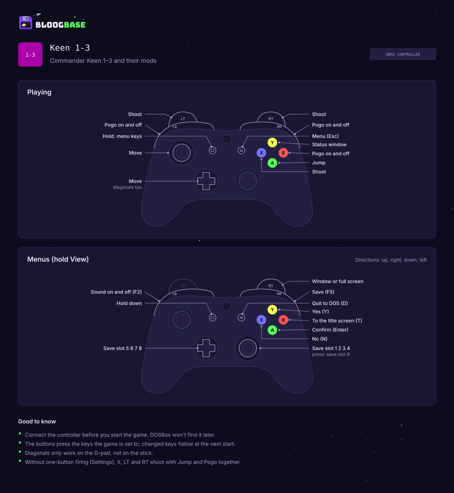
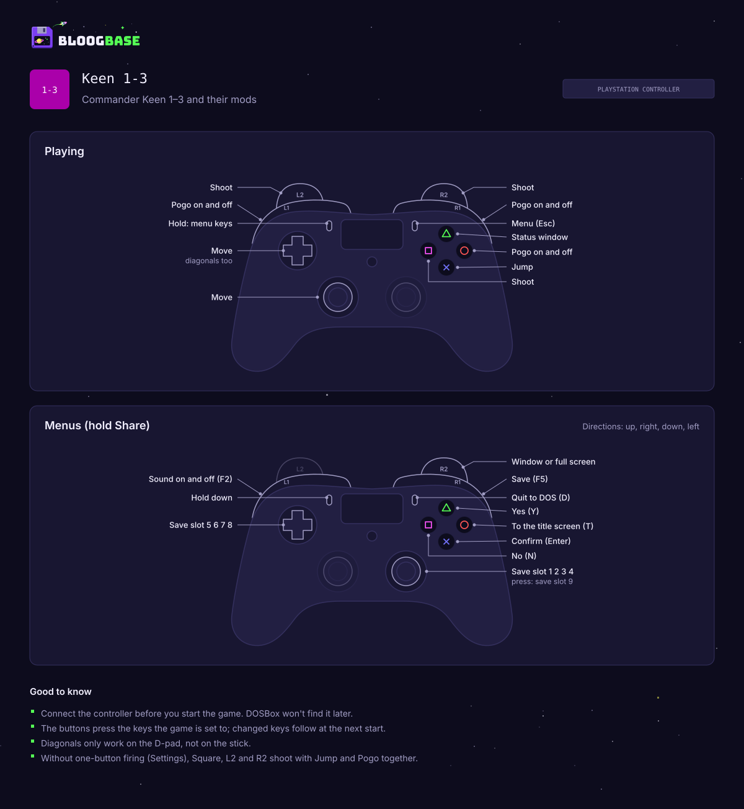
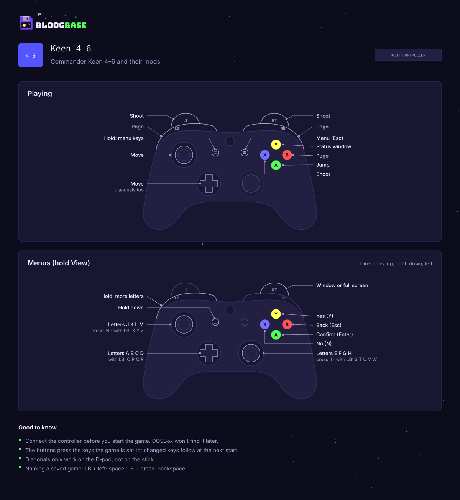
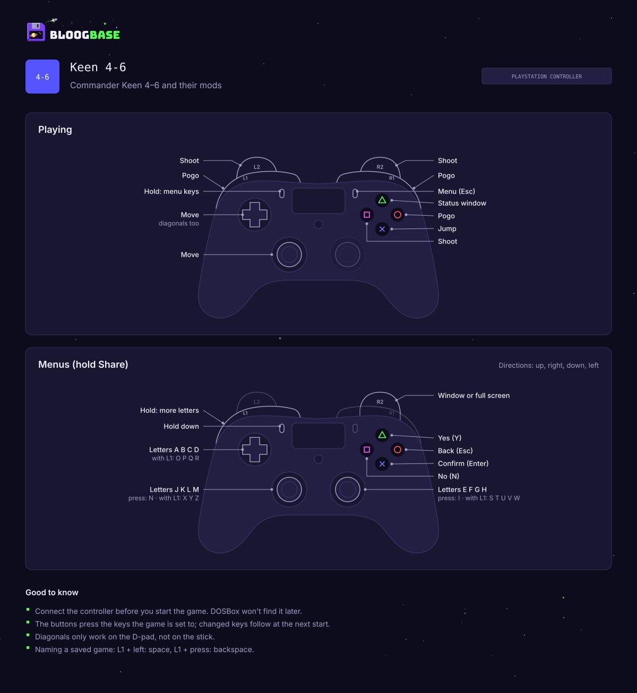
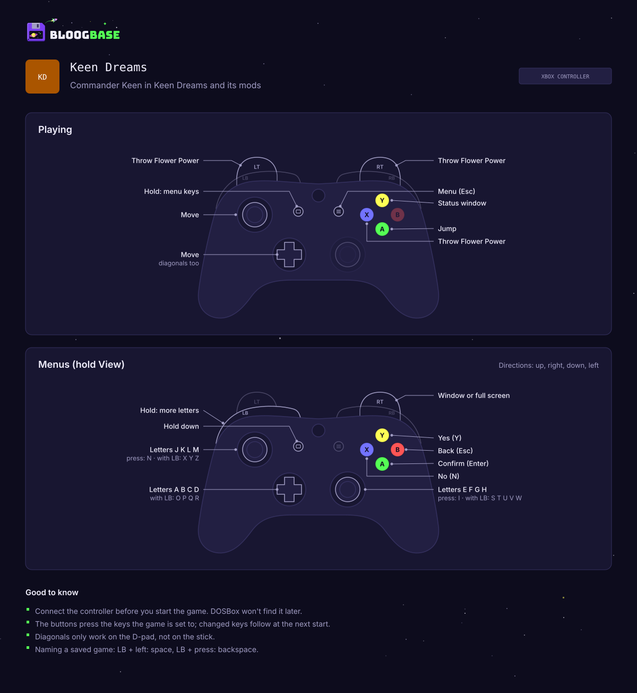
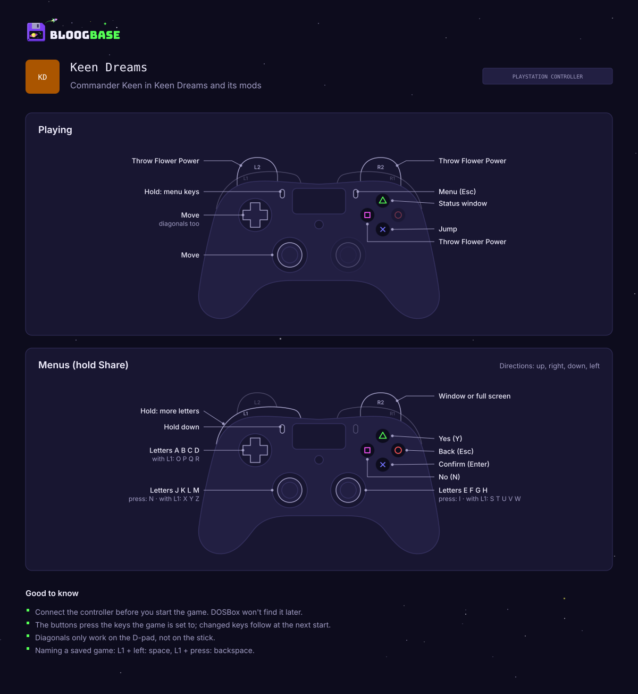
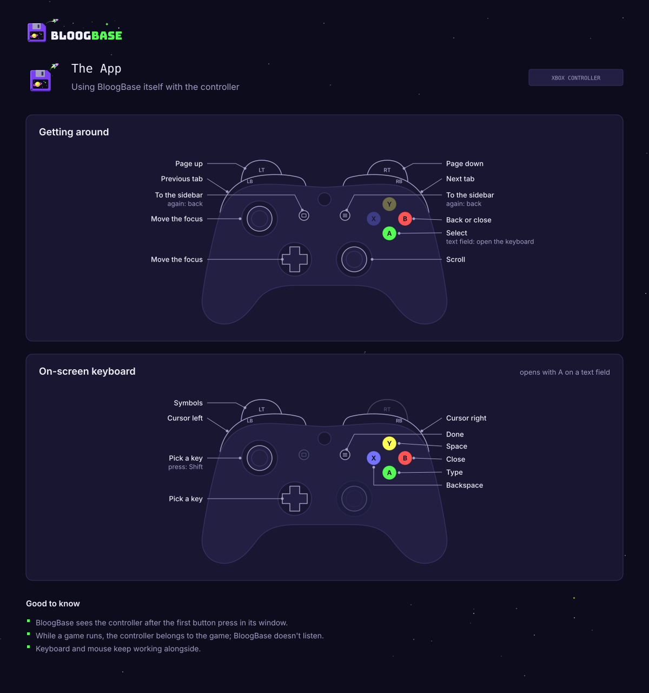
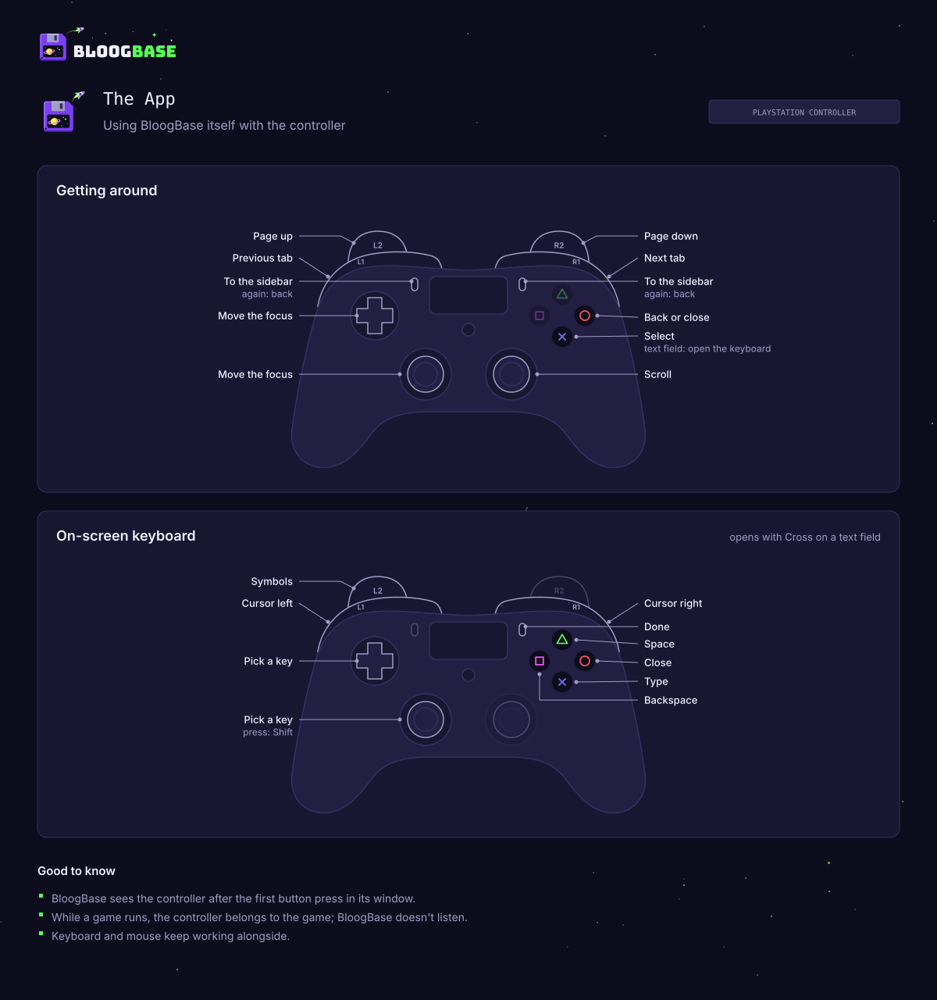

# Controllers

BloogBase takes a game controller in two places that never meet:

- **In the games**, DOSBox reads the controller through SDL2 and the
  profile's mapper file turns its buttons into key presses
  (`src-tauri/src/keymap.rs`, `controller.rs`).
- **In the app**, the frontend reads it through the Web Gamepad API and
  moves the focus, clicks and types itself (`src/gamepad/`).

The app reads the pad only while its own window has the focus, and the
webview reports no button changes while it's in the background, so input
meant for DOSBox never reaches the app. Keyboard and mouse keep working
beside the controller everywhere; there is no "controller mode".

Supported layouts are Xbox controllers (and pads that act as one) and
PlayStation controllers (DualShock 4, DualSense). The Windows numbers are
measured with both; on Linux the DualShock 4's are.

## At a glance

|             | Xbox controller                                                                          | PlayStation controller                                                                                        |
| ----------- | ---------------------------------------------------------------------------------------- | ------------------------------------------------------------------------------------------------------------- |
| Keen 1-3    |             |             |
| Keen 4-6    |             |             |
| Keen Dreams |  |  |
| The app     |                      |                      |

`scripts/controller-charts.mjs` draws them (`node scripts/controller-charts.mjs`,
`… <dir> de` for German). They repeat the bindings below and the drawing
of the Controls tab (`PadDrawing.tsx`), so redo them when `keymap.rs`,
`src/gamepad/` or the drawing changes.

## In the games

### Keys, not a joystick

The controller only presses keys. Games need no joystick setup and no
calibration, and the keys it presses are the ones the game is set to:
`game_settings::effective_keys` reads them from the game's settings file
(`CTLPANEL.CKx`, `CONFIG.CKx`, `KDREAMS.CFG`) after the global settings
went in, or takes the game's defaults where there's no file yet. A player
who moved Jump to `A` jumps with the controller too. Keys changed in the
game's own menu reach the controller at the next start.

The mapper file leaves out DOSBox's bindings of the controller to its
emulated joystick. Keen Dreams' menus read joystick buttons even in
keyboard mode, so with both the buttons would also pick menu entries.

### Playing

| Button (Xbox / PlayStation) | Keen 1-3      | Keen 4-6      | Keen Dreams           |
| --------------------------- | ------------- | ------------- | --------------------- |
| Left stick, D-pad           | move          | move          | move                  |
| A / ✕                       | jump          | jump          | `5`, then jump        |
| B, LB, RB / ○, L1, R1       | pogo          | pogo          | –                     |
| X, LT, RT / □, L2, R2       | fire          | fire          | throw                 |
| Y / △                       | status window | status window | status window (Space) |
| Menu / Options              | Esc           | Esc           | Esc                   |
| View / Share (held)         | menu keys     | menu keys     | menu keys             |

Fire in Keen 1-3 depends on one-button firing (`keymap::controls`):

- Where the patch is on and fits, or is built into the mod, the fire
  buttons press its fire key and Y presses Enter.
- Without it, the fire buttons press Jump and then Pogo, which shoots in
  Keen 1-3, and Y presses Space. One-button firing isn't forced on
  controller players.

Keen 4's special demo has no fire key in its settings and fires with
Space; a key DOSBox has no event for falls back to the game's default.

### Menu keys with View held

Saving, loading and naming need keys a pad doesn't have. Holding View
(Share) is DOSBox's third modifier (`mod_3`) and switches to the menu keys.
They differ between the engines.

Keen 1-3:

| With View held                    | Key                        |
| --------------------------------- | -------------------------- |
| A / B                             | Enter / `T` (title screen) |
| X / Y                             | `N` / `Y`                  |
| Menu                              | `D` (quit to DOS)          |
| RB / LB                           | F5 (save) / F2 (sound)     |
| Right stick up, right, down, left | save slots 1-4             |
| D-pad up, right, down, left       | save slots 5-8             |
| Right stick click                 | save slot 9                |

Keen 4-6 and Keen Dreams:

| With View held                           | Key                                           |
| ---------------------------------------- | --------------------------------------------- |
| A / B                                    | Enter / Esc                                   |
| X / Y                                    | `N` / `Y`                                     |
| D-pad up, right, down, left              | `A`-`D`                                       |
| Right stick up, right, down, left, click | `E`-`I`                                       |
| Left stick up, right, down, left, click  | `J`-`N`                                       |
| … with LB held too                       | `O`-`R`, `S`-`W`, `X` `Y` `Z` Space Backspace |

LB pressed with View held is DOSBox's first modifier (`mod_1`), a second
layer of letters for save names, and doesn't pogo. In every engine,
View+RT toggles window and full screen (DOSBox's `hand_fullscr`, as
Alt+Enter).

### The mapper file

Each profile has its own, `profiles/<id>/generated/keyboard.map`, written
at every start in `session::start` after `game_settings::apply` (only when
it changed) and named in the launch layer. DOSBox resolves the relative
`mapperfile` against the folder of the config file that names it. Older
versions wrote one file for all profiles, then one per engine, in
`configs/`; those are removed at launch. More on the layers in
[dosbox.md](dosbox.md).

Things the file has to get right:

- **It replaces all of DOSBox's bindings.** So it repeats Staging 0.83's
  defaults (`CreateDefaultBinds` in `gui/mapper.cpp`): keys, modifiers,
  hotkeys. The same file also moves the letters for non-US keyboard
  layouts. When the managed DOSBox version changes, the defaults have to be
  redone ([dependencies.md](dependencies.md)).
- **Emulated keys are bound**, not host keys, so the host's keyboard layout
  doesn't matter to the controller.
- **Keen takes the last of several keys pressed together.** One button
  pressing two menu keys only gives the second, so every menu key has a
  button of its own.
- **File order is press order.** A second line for an event adds bindings,
  and an input bound to several events presses them in the order of the
  file. That is how "Jump, then Pogo" and Keen Dreams' "`5`, then jump"
  work.
- **A binding with a modifier wins** over the same input without it, so
  with View held the game sees only the menu key, not the playing key on
  the same button.
- **Triggers rest at the negative end** of their axis. Only their positive
  half is bound; a binding on the negative half would hold its key all the
  time.

### Button numbers

DOSBox 0.83 binds raw SDL2 joystick numbers, and those depend on the pad
and the system. `keymap.rs` names every input by its place on an Xbox
controller (`Input`) and resolves it per layout and system
(`Numbering`, `fn sdl`, `fn sdl_linux`).

| Input                       | Windows Xbox | Windows PlayStation | Linux Xbox | Linux PlayStation |
| --------------------------- | ------------ | ------------------- | ---------- | ----------------- |
| A, B / ✕, ○                 | 0, 1         | 0, 1                | 0, 1       | 0, 1              |
| X, Y / □, △                 | 2, 3         | 2, 3                | 2, 3       | 3, 2              |
| LB, RB / L1, R1             | 4, 5         | 9, 10               | 4, 5       | 4, 5              |
| View, Menu / Share, Options | 6, 7         | 4, 6                | 6, 7       | 8, 9              |
| Stick clicks                | 8, 9         | 7, 8                | 9, 10      | 11, 12            |
| D-pad                       | hat 0        | buttons 11-14       | hat 0      | hat 0             |
| Left stick                  | axes 0, 1    | axes 0, 1           | axes 0, 1  | axes 0, 1         |
| Right stick                 | axes 2, 3    | axes 2, 3           | axes 3, 4  | axes 3, 4         |
| LT, RT / L2, R2             | axes 4, 5    | axes 4, 5           | axes 2, 5  | axes 2, 5         |

- On Windows, SDL2 reads an Xbox controller through XInput or Raw Input,
  and a DualShock 4 or DualSense itself (HIDAPI): 16 buttons, no hat, the
  D-pad as buttons 11-14 (up, down, left, right). DOSBox 0.83 sets no
  joystick hints, so it sees the HIDAPI layout.
- On Linux, SDL2 reads every pad through the kernel (evdev), which numbers
  buttons and axes in the order of its own codes. That swaps Triangle and
  Square against Windows and puts the left trigger on axis 2. The
  DualShock 4's numbers are measured in a VM; the Xbox controller's follow
  the same rule but aren't measured (VirtualBox's USB passthrough
  delivered no input from it).
- macOS is taken to number like Windows (not measured).

### Which controller

`controller::connected` finds the pad at every start:

- **Windows:** a PlayStation controller through Raw Input (Sony's vendor
  ID `054C` and the DualShock 4/DualSense product IDs), else any XInput
  pad as an Xbox controller. PlayStation comes first because SDL2 lists
  HIDAPI pads before XInput's, and DOSBox plays with the first. XInput
  answers in about 10 ms; gilrs (Windows.Gaming.Input) saw no pad on its
  first call and would have needed `libudev-dev` on Linux, and the Gamepad
  API only shows a pad after a button press.
- **Linux:** `/proc/bus/input/devices`; a joystick (`jsN` handler) with
  Sony's IDs is a PlayStation controller, any other an Xbox controller.
  The DualShock's touchpad has Sony's IDs too but no `js` handler.
- **macOS:** no answer yet; games get the Xbox layout.

Pads found wrongly or not at all: Settings > Controls sets the layout
(`controller.layout`: unset is automatic, else `xbox` or `playstation`). It
then counts for every connected controller and decides the mapper file
(`controller::for_game`) and the button names BloogBase shows.

### Limits of DOSBox

- **Connect before starting.** DOSBox looks for controllers only at its
  start. When it logs `MAPPER: No joysticks found`, BloogBase looks for one
  every two seconds while the game runs (`watch_for_late_controller`,
  Windows and Linux) and at the first asks the player to start the game
  again (`LateController`, until the game ends or the hint is closed).
- **No stick diagonals.** Staging 0.83 presses a key bound to a stick axis
  only above a fixed 25000 (76 %), and a round stick reaches about 71 %
  diagonally. `[joystick] circularinput` doesn't help: it only reshapes
  the emulated joystick, while key bindings read SDL's raw value. The
  D-pad covers diagonals. Upstream: issue
  [dosbox-staging#5162](https://github.com/dosbox-staging/dosbox-staging/issues/5162),
  fix in PR
  [#5166](https://github.com/dosbox-staging/dosbox-staging/pull/5166)
  (applies `circularinput` to key bindings on both sticks). Once BloogBase
  moves to a DOSBox with it and turns it on, the right stick held with View
  between about 37° and 53° presses two menu keys at once; Keen takes the
  last.
- **SDL3 numbers differently.** Staging's `main` uses SDL3: an Xbox
  controller has 11 buttons instead of 16 and LT on axis 2 (the right
  stick bindings would land on LT and hold a key), a DualShock 4 has its
  D-pad as hat 0. A move of the managed DOSBox to an SDL3 release means
  redoing the layouts in `keymap.rs` (`padprobe.py --check`, below).

### Mods with controller settings

A Keen 1-3 mod's `CTLPANEL.CKx` is left out on install (`mods::analyze`):
it holds only what the game's menus set (sound, input device, joystick
calibration, keys), and some mods ship their author's.

## Showing the controls

The Controls tab of a profile has a "Keyboard | Controller" switch,
preselected on Controller when one is connected (asked once, at most
300 ms, else taken as none). The controller view is an own drawing (no
maker's logo) with callouts for playing and, with View held, the menus,
plus a table of the keys the menu layer types. The data comes from
`src/profile/controlSheet.ts` and follows `keymap.rs`; the window and
recording keys stay keyboard keys and show in both views. Cheats show in
the keyboard view only.

With a PlayStation layout (found or chosen) the drawing gets the
PlayStation arrangement (D-pad up left, both sticks below, touchpad
between Share and Options), its symbols at the face buttons, and the
names L1/R1/L2/R2, Share and Options. The button colours are the
`--bb-pad-*` tokens, for both themes.

On the first start of a series, the controls dialog opens on the
controller view if a controller is connected, else on the keyboard's;
each is remembered apart (`bloogbase.controllerControlsShown`,
`bloogbase.controlsShown`). A controller player sees the keyboard sheet
later only when starting without the controller.

## In the app

### Reading the pad

`usePad` runs one `requestAnimationFrame` loop while a pad is connected
and reads the first pad with `mapping === "standard"`; others can't be
read reliably. `pad.ts` turns its state into actions and is pure, so the
tests feed it made-up states.

- Buttons count on the frame they go down. A pad shows up only after a
  button was pressed in the focused window, and that first press is
  already in the state, so a button down on the first frame counts too.
- A held direction repeats after 400 ms, then every 80 ms. LB, RB, LT and
  RT repeat every 250 ms, X (Backspace on the keyboard) every 80 ms.
- The triggers are analog and count from half way. The left stick has a
  dead zone of 0.5 and the larger axis wins; the right stick scrolls with
  a dead zone of 0.2.
- Nothing is read while the window has no focus (`document.hasFocus()`),
  on top of the webview holding back background input.

### Buttons

| Button            | Does                                                                                     |
| ----------------- | ---------------------------------------------------------------------------------------- |
| D-pad, left stick | moves the focus to the nearest element in that direction                                 |
| A                 | clicks the focused element, steps a select, opens the on-screen keyboard on a text field |
| B                 | closes a dialog or menu, else goes a page back                                           |
| Right stick       | scrolls                                                                                  |
| LB / RB           | previous / next tab, wrapping                                                            |
| LT / RT           | scrolls a page up / down                                                                 |
| View / Menu       | to the sidebar's current page; again, back where the focus was                           |

Details that matter:

- **Sent keys are untrusted.** A script-made key event moves no focus and
  clicks nothing, so `actions.ts` moves the focus and clicks itself. Our
  own handlers (dialogs, menus, tabs) do react to sent keys, so a
  component with its own arrow keys gets the key first and the spatial
  move happens only if nothing took it. `isPadKey` tells a sent key from a
  real one; the key dialog ignores the D-pad's keys and takes B as cancel.
- **Spatial focus is our own** (`spatial.ts`). `@bbc/tv-lrud-spatial` treats
  every `<nav>` and `<section>` as a container and jumps to its first
  element, and knows no `<select>` or `<textarea>`. Ours measures from the
  middle of the edge it leaves; a candidate may overlap that edge by 30 %.
  What lies in line with the focus (overlapping it across the direction)
  wins, nearest along the direction; only without one the nearest at all.
  Without that rule, down from a profile's back link went into the
  sidebar instead of the tabs.
- **Scope.** The focus stays inside an open menu, else the innermost and
  last open dialog, else the page. Elements inside `[inert]` or
  `[data-pad-ignore]` are skipped.
- **A with nothing focused** sends Enter, for a page's default action
  (`useEnterAction`). With nothing focused yet, a direction goes to the
  first element in view in `<main>`.
- **B** doesn't go back from the library or the setup.
- **Focus ring.** After `focus()` from a script, `:focus-visible` stays
  quiet once the mouse was used. Controller input sets
  `data-input="pad"` on the document, which shows the ring (`index.css`);
  the mouse removes it.
- **LB/RB** send the arrow key to the selected tab, so the logic stays in
  `Tabs`. The focus follows into the new tab only from the tab list or the
  panel that goes away; elsewhere (the Play button) it stays. Inside a
  dialog, only the dialog's tabs switch.
- **LT/RT** scroll the scroll container around the focus (else the open
  dialog's, else `<main>`) by 90 % of its height. If the focus would leave
  the view, it moves to the first element in view in that direction, so
  the D-pad carries on from what's on screen.
- **View/Menu** do nothing while a dialog or menu is open or in the setup
  (no sidebar there).

### The on-screen keyboard

A on a text field (`text`, `search`, `url`, `email`, `tel`, `number`, text
areas) opens a keyboard of our own, docked at the bottom
(`src/gamepad/keyboard/`). The systems' keyboards don't fit: Windows' is
Windows only, macOS's isn't made for a pad, Linux has none, Steam's runs
only under Steam. The config editor (CodeMirror) and the key dialog keep
needing a real keyboard.

| Button  | Does                                |
| ------- | ----------------------------------- |
| A       | types the focused key               |
| X       | Backspace                           |
| Y       | Space                               |
| LB / RB | caret left / right                  |
| LT      | symbols page                        |
| L3      | Shift (one letter), twice Caps Lock |
| Menu    | Done                                |
| B       | closes it, the text stays           |

- QWERTZ with umlauts and ß in German, QWERTY in English (the app's
  language, not the system's), a symbols page for addresses, digits only
  for number fields.
- The focus stays in the field the whole time, so it keeps its caret and a
  dialog around it keeps its keys. The keyboard keeps its own place on the
  keys with a grid step of its own and takes every button first
  (`keyboardAction`); B closes only the keyboard, not the dialog.
- Typing goes through the native `value` setter and an `input` event, so
  React sees it; `maxLength` and a selection are respected.
- Done sends Enter to the field first (a field's own Enter rule, such as a
  mod's name while there's a warning, comes first) and submits the form
  only if nothing took it. Number fields lose the focus, since Settings
  saves them then.
- A real key pressed while it's open closes it and the keyboard user
  carries on in the field. The page and dialogs get room below for it
  (`--bb-pad-keyboard`).
- Its hint row is the only button hint in the app, in the `--bb-pad-*`
  colours.

### Before the first press

The Gamepad API shows a pad only after a button was pressed in the window.
Where BloogBase can tell earlier (`controller_connected`: Windows, Linux),
`PadHint` shows a slim pill asking for a press while a pad is connected
that the webview doesn't show yet. It isn't asked while DOSBox is in
front, and its cross hides it until the app starts again.

### Button names

The layout chosen in the settings names the buttons everywhere. Without
one, the Controls tab and the press hint go by the layout Rust found, and
the on-screen keyboard by the pad the webview sees: Sony's vendor ID
`054c` in its Gamepad API id means PlayStation, anything else Xbox
(`buttons.ts`).

### Webviews

| System                            | Gamepad API                                                   |
| --------------------------------- | ------------------------------------------------------------- |
| Windows (WebView2)                | checked with a real pad: standard mapping, 17 buttons, 4 axes |
| macOS (WKWebView)                 | available, untested with a real pad                           |
| Linux (WebKitGTK with libmanette) | available, untested with a real pad                           |

The app logs "Gamepad API available/missing/fails" at start, and the CSP
smoke test shows the line per system ([testing.md](testing.md)).

## Tools and tests

`scripts/padprobe.py` shows how SDL numbers a controller's inputs, with
the binding `keymap.rs` needs for each. `--sdl` (required) names the exact
SDL2 or SDL3 library to test: on Windows the DLL next to `dosbox.exe`, on
Linux (DOSBox has SDL built in) `pysdl2-dll` of the same version.

- `--check` asks for each input in turn and reports any that arrive
  differently from `keymap.rs` (read from `fn sdl` or `fn sdl_linux`, the
  PlayStation IDs from `controller.rs`) or are pressed at rest.
- `--live` prints inputs as they're used; `--dosbox` adds what DOSBox's
  mapper logs.
- `--check` and `--live` open a small window and wait for its focus: SDL2
  reads an Xbox controller through Raw Input, which delivers nothing to a
  program without a focused window
  (`SDL_JOYSTICK_ALLOW_BACKGROUND_EVENTS` doesn't help).

Run `--check` with an Xbox and a PlayStation controller after every DOSBox
update ([dependencies.md](dependencies.md)). WSL is no use for Linux
measurements (its kernel lacks the pad drivers); a VM with USB passthrough
and the pads on a cable is.

Unit tests: `cargo test --lib keymap` and `controller` for the mapper file
and detection, `pnpm exec vitest run src/gamepad` for the app side,
`src/profile` for the Controls tab. `cargo test --lib controller --
--ignored print_connected` prints what `connected` finds with a pad
plugged in.

## Not yet checked

- A DualSense (taken to share the DualShock 4's layout).
- An Xbox controller on Linux, and whether SDL2 reads a DualShock through
  HIDAPI with the Windows numbering when it may open `/dev/hidraw*` (udev
  rules from Steam's `steam-devices`).
- Real pads in the macOS and Linux webviews; detection on macOS.
- Steam Deck, Switch Pro controllers and generic DirectInput pads.
